# VoltOpt

VoltOpt is a Julia codebase for fast spectral discretization of Volterra integral
operators and Volterra-type equations.  The implementation centers on polynomial
bases, restriction matrices, and fast assembly/application routines for kernels
on triangular Volterra domains.

## Main Features

- Chebyshev utilities:
  - value/coefficients transforms with DCT-I/FFT,
  - two-dimensional Chebyshev interpolation helpers,
  - Chebyshev integration and multiplication matrices.
- Restriction matrices:
  - `restmat_cheb(a, b, N)` for Chebyshev coefficients,
  - `restmat_jacobi(a, b, N, alpha, beta)` for Jacobi coefficients.
- Volterra matrix assembly:
  - `voltmat_cheb` / `VoltMat_Cheb.voltmat_cheb` for Chebyshev-basis square Volterra matrices,
  - `weak_voltmat_cheb` / `Weak_VoltMat_Cheb.weak_voltmat_cheb` for weakly singular Chebyshev/JFP Volterra matrices,
  - `voltmat_leg` / `VoltMat_Leg.voltmat_leg` for Legendre-basis matrices,
  - `voltmat_jacobi` / `VoltMat_Jacobi.voltmat_jacobi` for Jacobi-basis matrices.
- Fast composed/nonlinear Volterra actions:
  - `compVolt`, `compVolt_fast`,
  - `compVolt_nonlinear_fast`,
  - Newton-GMRES matrix-free helpers such as `compVolt_newton_jv!`.
- Example scripts for first-kind and second-kind Volterra equations, stiff
  integro-differential equations, pseudospectra, and nonlinear Volterra-Urysohn
  Picard iteration.

## Package Usage

From the repository root:

```powershell
julia --project=.
```

Then in Julia:

```julia
using VoltOpt

K(x, t) = exp(-(x - t)^2)

B_cheb = voltmat_cheb(K, 32)
B_leg  = voltmat_leg(K, 32)
R      = restmat_cheb(-1.0, 0.0, 32)
```

For weakly singular Volterra kernels, VoltOpt also supports operators of the
form

```math
(\mathcal{V}_K u)(x)
=
\int_{-1}^{x}
(x-y)^{-\mu} K(x,y) u(y)\,dy,
```

where `K(x,y)` is smooth and the algebraic singularity is handled in a
Chebyshev/JFP-type weighted basis.  The constructor lives in
`src/VoltMat/weak_voltmat_cheb.jl` and is exported as `weak_voltmat_cheb`:

```julia
using VoltOpt

K(x, y) = exp(-x * y)

V, info = weak_voltmat_cheb(
    K;
    mu = 0.25,
    sigma = 0.0,
    beta = 1.25,
    N = 32,
)
```

You can also access the implementation modules directly:

```julia
using VoltOpt

B = VoltMat_Cheb.voltmat_cheb(K, 32)
W = Weak_VoltMat_Cheb.weak_voltmat_cheb(K; mu=0.25, sigma=0.0, beta=1.25, N=32)
L = VoltMat_Leg.voltmat_leg(K, 32)
J = VoltMat_Jacobi.voltmat_jacobi(K, 32, 0.0, 0.0)
```

For nonlinear Volterra actions:

```julia
using VoltOpt

grid = CompVoltGrid(64)
cu = zeros(65)
cu[1] = 1.0

Knl(x, t, u) = u / (1 + (x - t) * u^2)
Vu = compVolt_nonlinear_fast(Knl, cu; grid=grid, truncate_output=true)
```

## Examples

This project currently provides seven example studies.  The scripts write their
main numerical outputs to `examples/figures`; the previews below use checked-in
PNG files for GitHub rendering.

### Example 1. Aging Maxwell second-kind Volterra equation

`examples/ex1_2ndVolterraEqn/ex1_aging_maxwell.jl` solves a manufactured
second-kind Volterra equation

```math
u(x) + \int_{-1}^{x} K(x,y)u(y)\,dy = f(x),
```

with an aging Maxwell-type smooth kernel
`K(x,y)=exp(-(x-y)/tau(x,y))/tau(x,y)` and an exact solution containing two
narrow smoothed step layers.  The script assembles `voltmat_cheb_square`,
checks convergence in values and coefficients, and compares the numerical and
exact solutions.

| Solution | Error convergence |
|:---:|:---:|
| 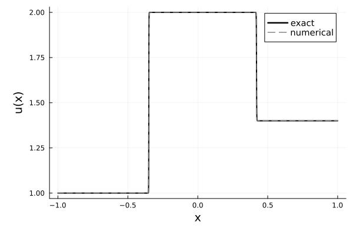 | 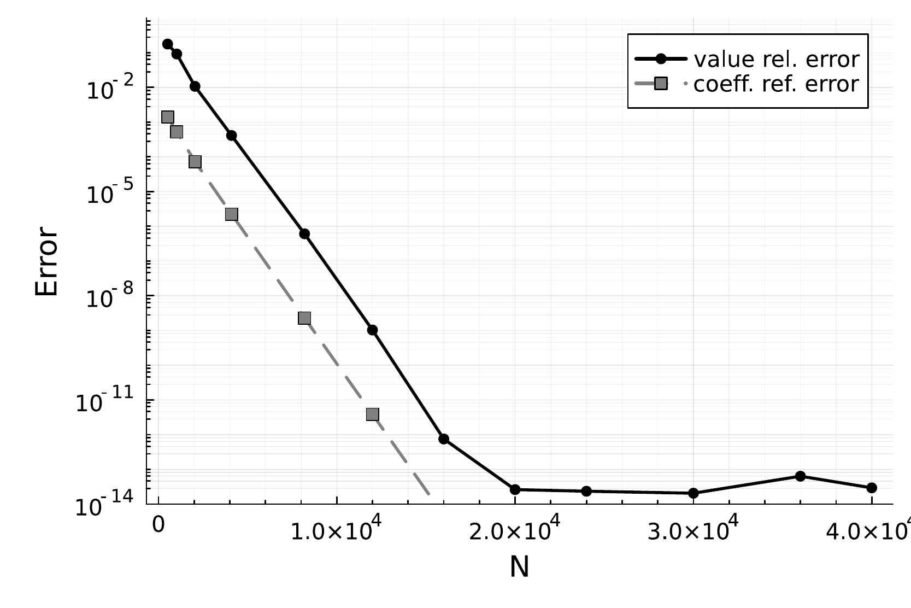 |
| The numerical solution matches the manufactured exact solution. | The error decreases as the truncation dimension \(N\) increases. |

| Coefficients | Right-hand side |
|:---:|:---:|
| 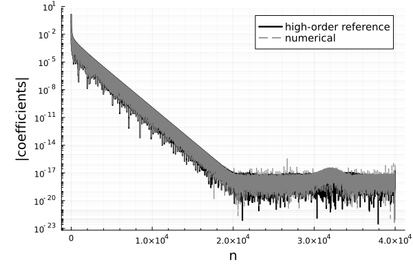 | 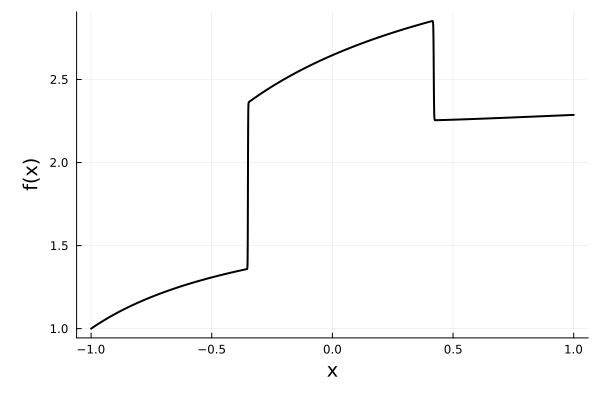 |
| The coefficient magnitudes show spectral decay. | The plot shows the manufactured forcing term used in the equation. |

### Example 2. First-kind Volterra equation: direct vs differentiated

`examples/ex2_1stVolterraEqn/ex2_firstkind_direct_vs_differentiated.jl`
compares solving a first-kind equation directly,

```math
V_K u = f,
```

against differentiating it to a second-kind equation,

```math
(I + V_{K_x})u = f',
```

for two smooth Gaussian-type kernels.  The figures show max-error convergence
for both approaches.

| Kernel K1 | Kernel K2 |
|:---:|:---:|
| 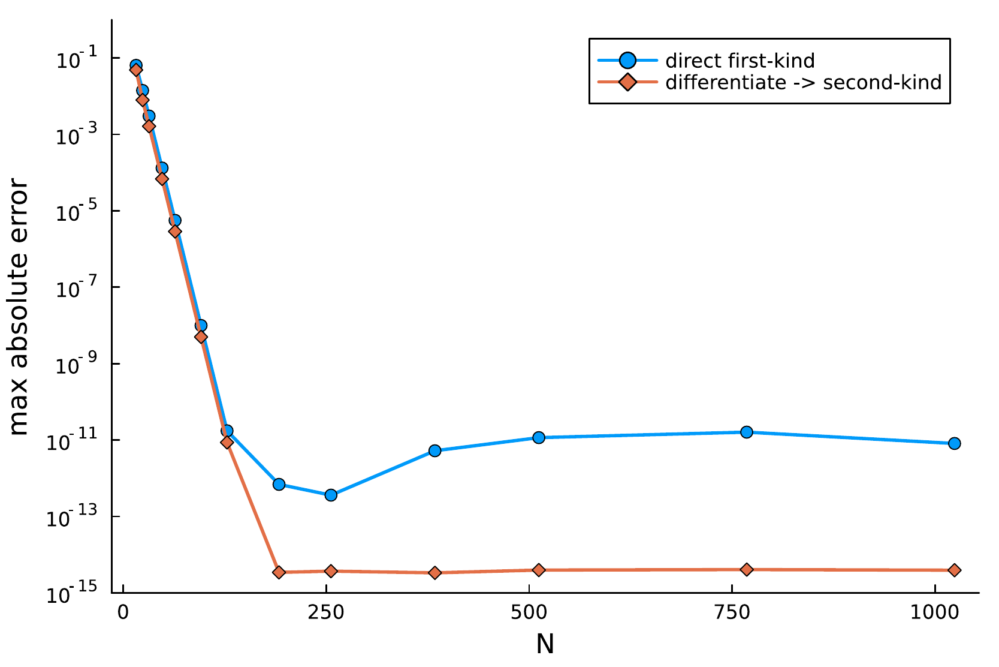 | 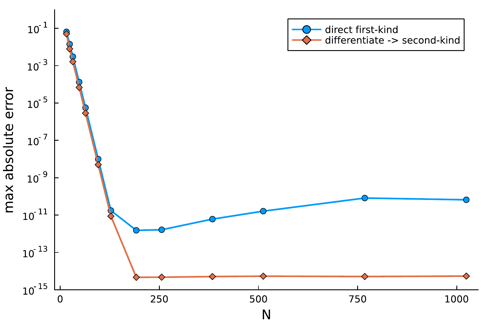 |
| The curve compares direct first-kind solving with the differentiated second-kind formulation. | The curve repeats the direct-versus-differentiated comparison for the second kernel. |

### Example 3. Pantograph first-kind Volterra equation

`examples/ex3_pantograph/ex3_pantograph_firstkind.jl` solves a pantograph
first-kind Volterra problem with delay ratio `q=0.5`.  It uses Chebyshev
restriction matrices `restmat_cheb`, Chebyshev multiplication, and
`voltmat_square_from_coeffmat_fft_convolution` to assemble the coupled system.
The script also checks matrix structure and writes a sparsity plot for the
`N=100` system matrix.

| BigFloat RHS error | BigFloat RHS big-truth error |
|:---:|:---:|
|  | 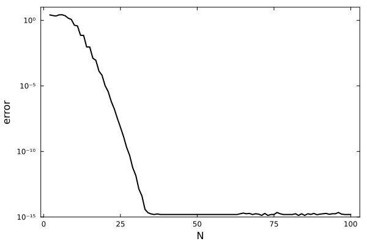 |
| The maximum error is shown for the high-precision right-hand side. | The curve compares the high-precision solution against the big-truth reference. |

| Float64 RHS error | Float64 RHS big-truth error | Matrix sparsity |
|:---:|:---:|:---:|
| 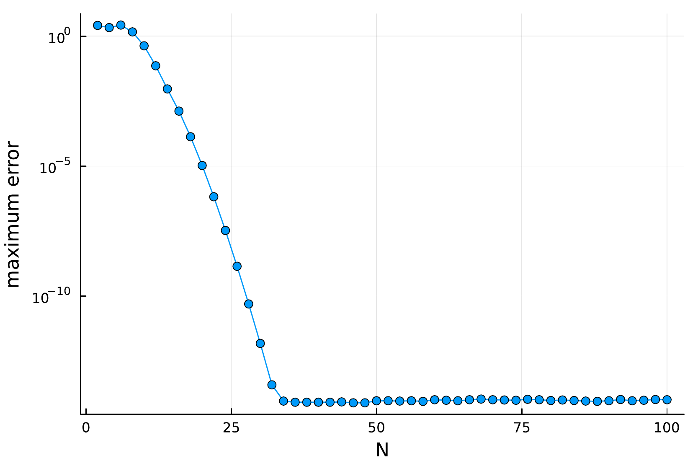 | 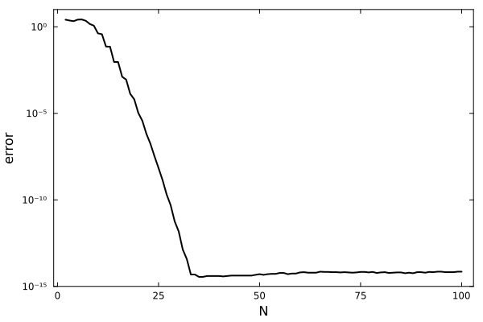 | 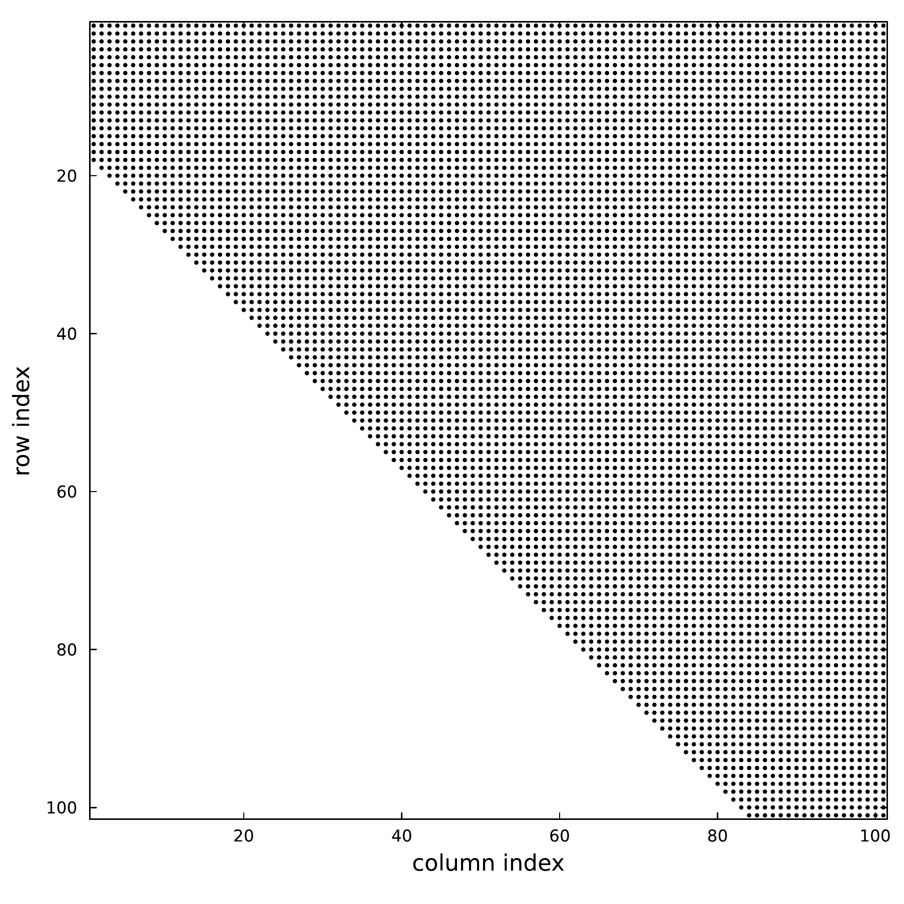 |
| The maximum error is shown for the Float64 right-hand side. | The curve measures the Float64 RHS solution against the big-truth reference. | The sparsity plot shows the assembled \(N=100\) coupled system. |

### Example 4. Singularly perturbed Volterra integro-differential equation

`examples/ex4_SPVIDE/ex4_SPVIDE.jl` solves a singularly perturbed
Volterra integro-differential equation with `eps=1e-7`, `mu=-1`, and exact
solution `sin(t) + exp(-t/eps)`.  The script builds a rectangular
Chebyshev/ultraspherical tau system, uses `voltmat_cheb_square` for the
Volterra term, and reports true and Cauchy-type errors as `N` grows.

| Solution | True error | Cauchy coefficient error |
|:---:|:---:|:---:|
| 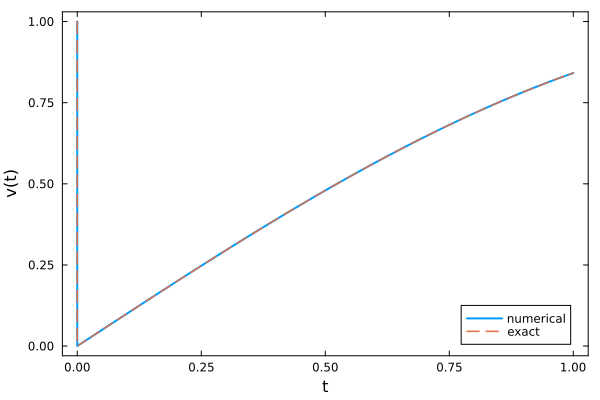 | 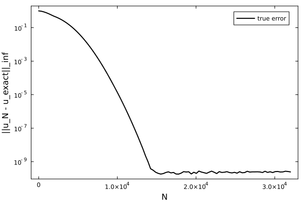 | 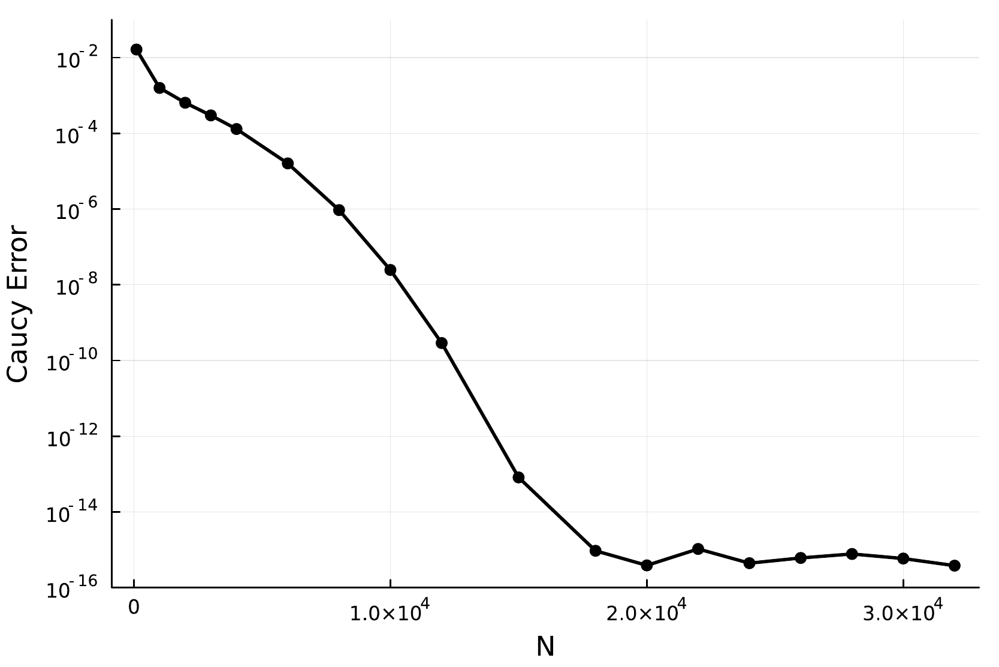 |
| The numerical solution is compared with the exact boundary-layer solution. | The true error is tracked as \(N\) grows. | The Cauchy coefficient error monitors convergence of the coefficient tail. |

### Example 5. Legendre Volterra pseudospectrum

`examples/ex5_psespectra/ex5_volterra_schur_besselj1.jl` assembles a complex
Legendre-basis Volterra matrix for
`K(x,y)=-im*besselj(1, 2*(x-y)+x*y)`, normalizes it, forms a Schur
triangular factor, and computes a shifted-SVD pseudospectrum grid.

| Pseudospectrum |
|:---:|
| 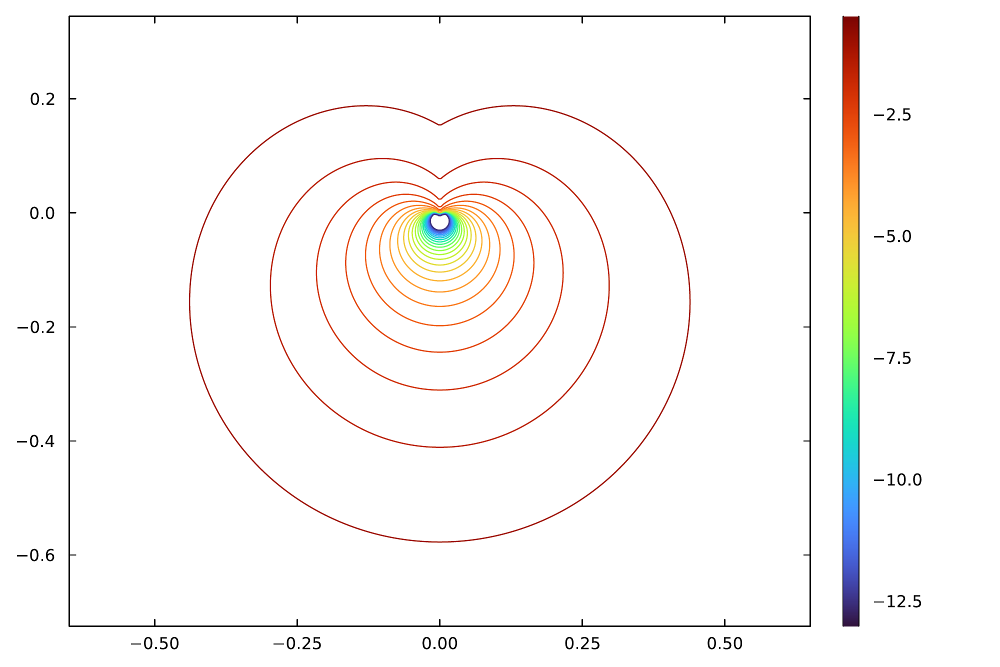 |
| The contour plot shows the shifted-SVD pseudospectrum of the normalized Volterra matrix. |

### Example 6. Nonlinear Volterra-Urysohn Picard iteration

`examples/ex6_nonlinear/ex6_nonlinear_picard.jl` solves a nonlinear
saturated-memory Volterra-Urysohn equation with

```math
K(x,t,u) = \frac{u}{1+(x-t)u^2}.
```

It uses `compVolt_nonlinear_fast` inside Picard iteration and compares the
computed solution with a manufactured Lambert-W-based exact solution.  The
iteration-history plot shows error and update decay.

| Solution | Picard error decay |
|:---:|:---:|
| 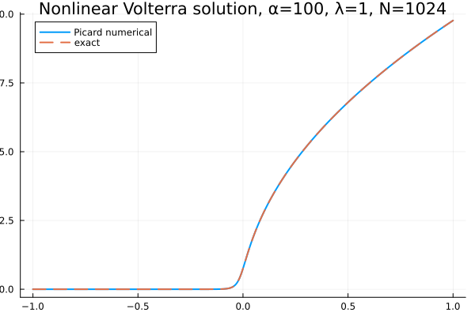 | 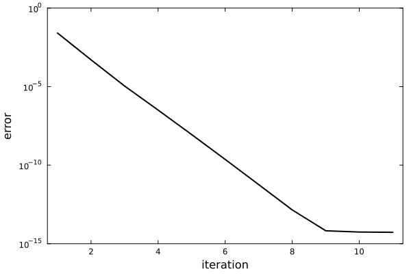 |
| The Picard solution is compared with the Lambert-W manufactured exact solution. | The iteration history shows both solution error and Picard update decay. |

### Example 7. Weakly singular rational-kernel Volterra equation

`examples/ex7_weaksingular/ex7_weaksingular.jl` solves a weakly singular
second-kind Volterra equation using `weak_voltmat_cheb`.  The smooth part is

```math
K(x,y)=\frac{1}{(x+1)^2+(y-1)^2},
```

with `mu=-0.5`, `beta=mu+1`, and a Joukowski/Fourier-polynomial-style mapped
Chebyshev basis.  A BigFloat tanh-sinh quadrature is used to project the
right-hand side, and the figures show convergence plus the numerical/exact
solution comparison.

| Solution | Error convergence |
|:---:|:---:|
| 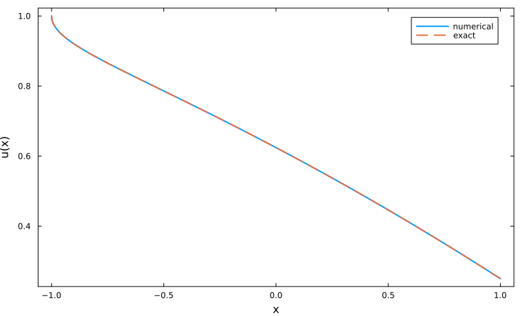 | 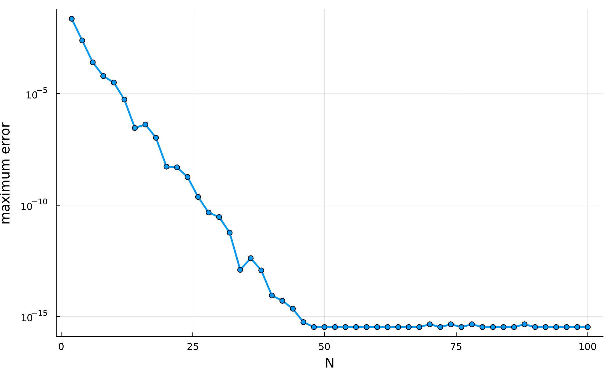 |
| The numerical solution is compared with the exact weakly singular solution. | The maximum error is shown as the truncation dimension \(N\) increases. |

## Benchmark Figures

The following timing figures summarize matrix-construction behavior from the
benchmark scripts in `test/`.  They include fixed-kernel-complexity/varying-`N`,
fixed-`N`/varying-bandwidth, and weakly singular `weak_voltmat_cheb` timings.

### Smooth-kernel assembly timings

| Runtime vs \(N\) | Runtime vs kernel size |
|:---:|:---:|
| 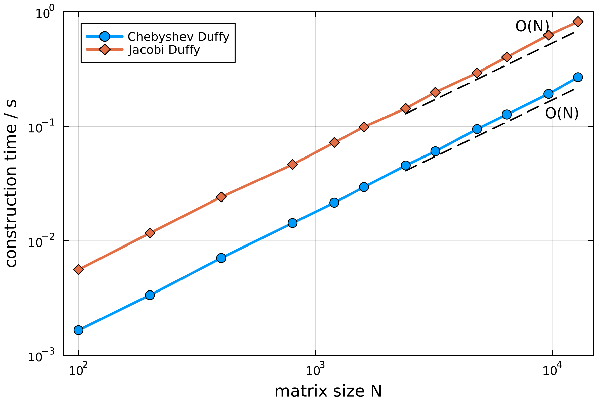 | 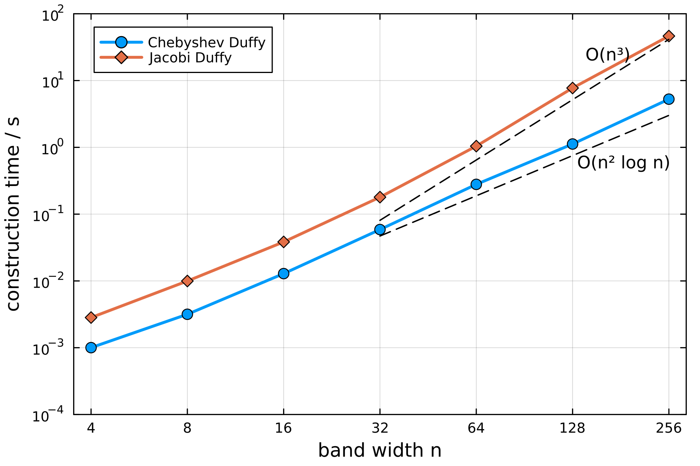 |
| Assembly time is shown as the matrix dimension \(N\) increases. | Assembly time is shown as the kernel expansion size increases. |

### Weakly singular assembly timings

| Runtime vs \(N\) | Runtime vs kernel size |
|:---:|:---:|
| 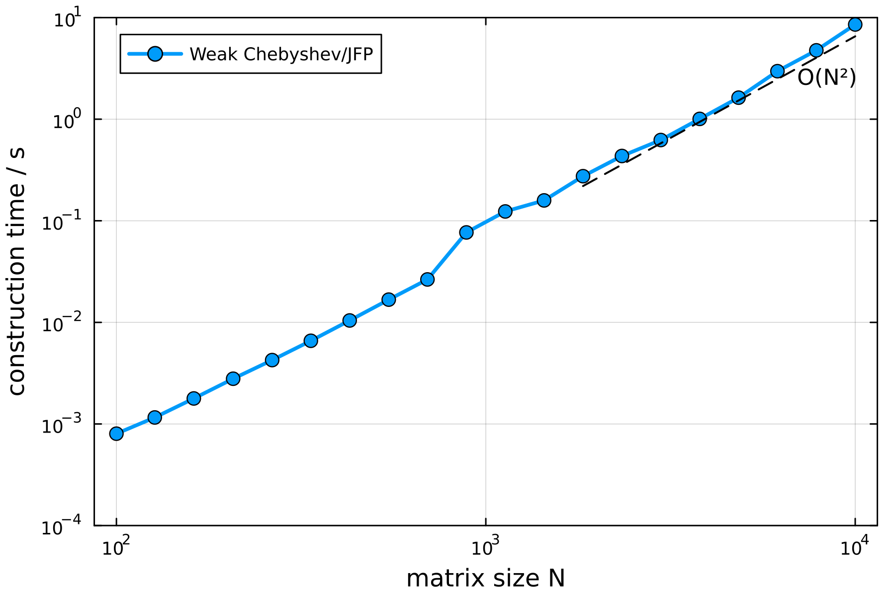 | 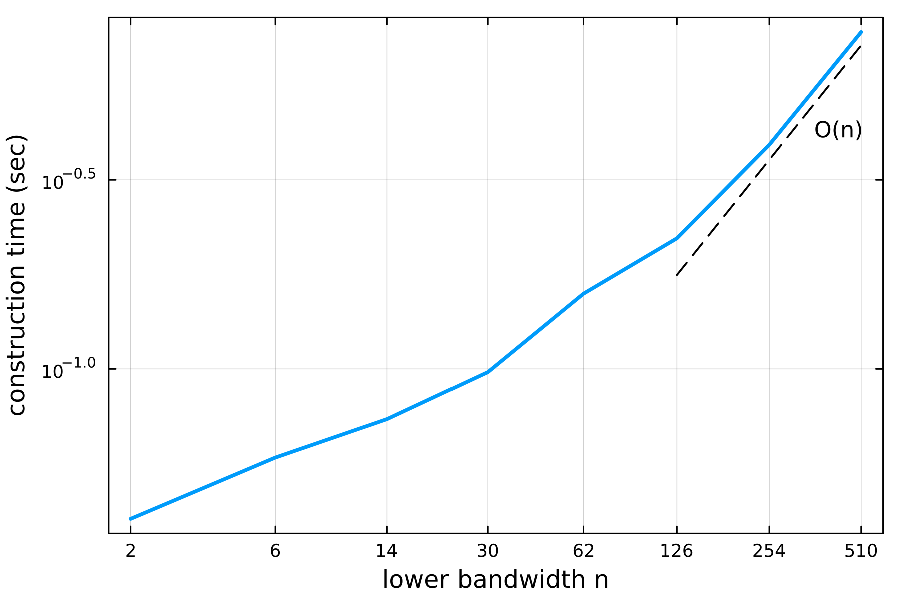 |
| Weak-kernel assembly time is shown as the matrix dimension \(N\) increases. | Weak-kernel assembly time is shown as the bandwidth or coefficient size increases. |

## Reproducing the Examples

Run examples from the repository root with the project environment:

```powershell
julia --project=. examples/ex1_2ndVolterraEqn/ex1_aging_maxwell.jl
julia --project=. examples/ex2_1stVolterraEqn/ex2_firstkind_direct_vs_differentiated.jl
julia --project=. examples/ex3_pantograph/ex3_pantograph_firstkind.jl
julia --project=. examples/ex4_SPVIDE/ex4_SPVIDE.jl
julia --project=. examples/ex5_psespectra/ex5_volterra_schur_besselj1.jl
julia --project=. examples/ex6_nonlinear/ex6_nonlinear_picard.jl
julia --project=. examples/ex7_weaksingular/ex7_weaksingular.jl
```

The standalone example scripts are the seven files above.  The file
`examples/ex5_psespectra/VoltMat_Leg.jl` is an auxiliary local helper, not a
separate example.  All maintained example outputs are written to:

```text
examples/figures
```

with filenames beginning with the example number, such as `ex1_...`,
`ex2_...`, and so on.

Some examples are computationally heavy and may take tens of seconds or longer
depending on the machine.

## Reproducing the Benchmarks

Benchmark data are written to `test/data`, and the plotting scripts write PDFs
and PNGs to `test/figures`:

```powershell
julia --project=. test/bench_fixedC_varyN.jl
julia --project=. test/bench_fixedN_varyC.jl
julia --project=. test/bench_weak_fixedC_varyN.jl
julia --project=. test/bench_weak_fixedN_varyC.jl

julia --project=. test/plot_varyNtime.jl
julia --project=. test/plot_Ctime.jl
julia --project=. test/plot_weak_varyNtime.jl
julia --project=. test/plot_weak_Ctime.jl
```

## Source Layout

```text
src/VoltOpt.jl               package entry point and exports
src/CompVolt/                fast composed and nonlinear Volterra actions
src/VoltMat/                 Chebyshev, Legendre, and Jacobi Volterra matrices
src/VoltMat/weak_voltmat_cheb.jl
                              weakly singular Chebyshev/JFP Volterra matrices
src/RestMat/                 restriction matrices
src/cheb*.jl, src/vals2cheb.jl
                              Chebyshev transform and helper routines
examples/                    reproducible numerical examples
examples/figures             generated CSV/PDF/PNG outputs
test/                        benchmark scripts
test/data                    benchmark CSV outputs
test/figures                 benchmark timing figures
```

## Notes

- The main package entry point now imports and re-exports the primary routines.
- Smooth-kernel Volterra matrix constructors handle nonsingular kernels.  The
  weak Chebyshev/JFP constructor handles endpoint/history-variable weak
  singular weights; the resulting matrices may use lower-banded upper
  Hessenberg or related sparse storage rather than a simple approximately
  banded smooth-kernel structure.
- Some example scripts are computationally heavy and may take tens of seconds or
  longer depending on the machine.
- `FastAlmostBandedMatrices` is used opportunistically by some examples; when
  the optional fast path is unavailable, those scripts fall back to sparse LU.
